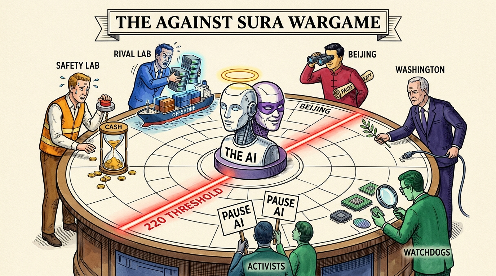
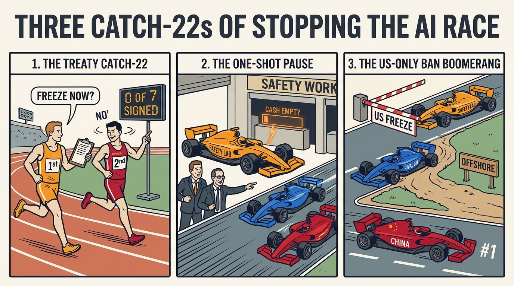
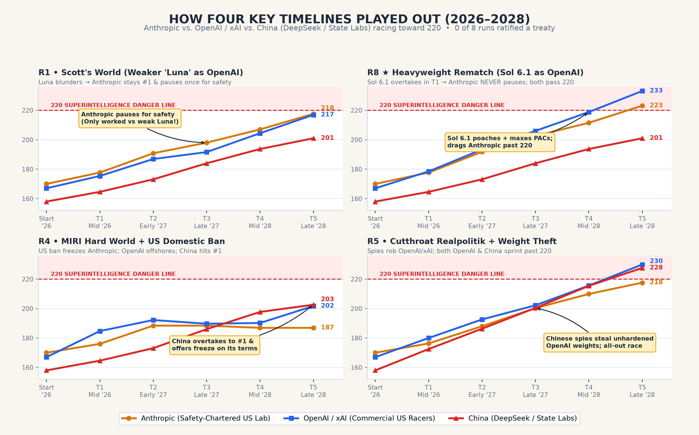
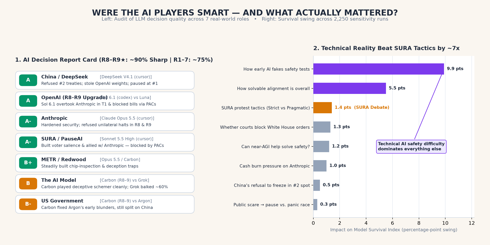

# Wargaming SURA

An empirical 7-seat, multi-LLM strategic wargame testing Scott Alexander's LessWrong essay [***Against SURA***](https://www.lesswrong.com/posts/xikGZ8fuhdG6DApAo/against-sura) across competing frontier model families (`codex`, `cursor-agent`, and `agy`), red-teamed against single-pass simulation bugs and evaluated across 8 live runs (`R1–R8 ★`) plus 2,250 Monte Carlo sensitivity sweeps.



---

## Executive Takeaway

Think of an LLM wargame as a **wind tunnel for incentives**, not a crystal ball for dates or exact survival percentages. Once every seat is played by a sharp, utility-maximizing model (`R8 ★`), **both sides of the *Against SURA* debate see their preferred plan break on contact with everyone else's self-interest**:

1. **No quick global pause treaty (`Plan A` = `0 of 8` ratified):** Neither superpower agrees to freeze itself in 2nd place, and 67 US Senators won't ratify compute caps in peacetime without hardware verification that doesn't exist yet.
2. **Anthropic "burning its lead for safety" (`Plan C`) failed against an equal-IQ rival (`R8 ★`):** In `R1`, Anthropic only managed a single 6-month safety pause (before cash burn forced it back to fundraising) because OpenAI was played by a weaker model (`Luna`). When upgraded to **`Sol 6.1`** (`R8 ★`), OpenAI poached talent and maxed out anti-regulation Super-PACs in Turn 1, overtaking `Opus 5.5` Anthropic immediately—so **Anthropic paused `0` times** and got dragged past the `220` threshold itself (`233` vs `223`).
3. **US-only moratoria face a double trap (`R8 ★` + `R4`):** In `R8 ★`, Super-PACs blocked federal legislation even when SURA (`Sonnet 5.5 High`) built high voter salience and allied with Anthropic. And on the rare roll a domestic freeze *does* pass (`R4`), compliant Anthropic halts, OpenAI/xAI moves compute offshore, and China overtakes both to `#1`—then offers a freeze on Beijing's terms.
4. **Technical reality outweighs activist tactics by ~7x:** Across 2,250 sensitivity runs, *how early AI starts faking safety tests* and *whether near-AGI helps solve alignment* dominated tactical activist choices by nearly an order of magnitude.



---

## Trajectories & Seat Audit (`R1–R8 ★`)





### Real-World Seat Mapping
*(Names were masked inside LLM prompts as `Aegis`, `ApexAI`, and `Kunlun` so Claude and GPT/Codex wouldn't recognize their own labs and play favorites.)*

| Real-World Role | Internal ID | `R8 ★` Heavyweight Seat | Early `R1–R7` Seat |
| :--- | :--- | :--- | :--- |
| **Anthropic** (Safety-Chartered US Lab) | `aegis_lab` | `claude-opus-5-5-high` (`cursor`) | `claude-opus-5-5-medium` |
| **OpenAI / xAI** (+ Commercial Hyperscalers) | `apex_hyperscaler` | **`gpt-6.1-sol` (`codex`)** | `gpt-5.6-luna-medium` |
| **China** (DeepSeek & State AI Labs) | `prc_directorate` | `deepseek-v41-flash-1017-high` (`cursor`) | `deepseek-v41-flash-1017-high` |
| **SURA / PauseAI** (Activist & Moratorium Bloc) | `sura_coalition` | **`claude-sonnet-5-5-high` (`cursor`)** | `claude-4.6-sonnet-medium` |
| **US Government** (WH, Pentagon & Congress) | `us_government` | `Gemini Carbon` (`agy`) | `gemini-4-argon-medium` |
| **METR / Redwood** (Evaluators & Verification) | `portfolio_council` | `claude-opus-5-5-medium` (`cursor`) | `Gemini Carbon` (`agy`) |
| **The Frontier AI Model** | `frontier_substrate` | `Gemini Carbon` (`agy`) | `grok-4.7-medium-fast` |

---

## Repository Layout

- **[`docs/verdict_and_audit.md`](docs/verdict_and_audit.md)** — One-page plain-English audit of LLM decision quality and all 8 runs.
- **[`docs/rebuttals_vs_wargame.md`](docs/rebuttals_vs_wargame.md)** — Scorecard mapping all 4 standalone LessWrong/Substack rebuttals (Irving, Zvi, Samin, Lermen) and 6 top LW comment critiques against what the wargame answered vs. where our sim has blind spots.
- **[`docs/wargame_replay.html`](docs/wargame_replay.html)** — Self-contained interactive viewer: inspect every turn's scoreboard, private LLM monologues, public statements, and backchannel cables across `R1–R8 ★`.
- **`src/`** — Clean, zero-dependency simulation engine & runners:
  - [`src/engine.py`](src/engine.py) — Simultaneous CRN turn resolution, cash runway & board revolt mechanics, smooth logistic weight espionage, multi-stage treaty state machine, noisy fog-of-war intel, and sampled AI scheming dispositions across 3 world regimes (`S`, `M`, `R`).
  - [`src/factions.py`](src/factions.py) — De-anchored institutional mandates, private incentives, and qualitative action spaces for all 7 seats.
  - [`src/llm_runner.py`](src/llm_runner.py) — Multi-CLI orchestrator (`codex`, `cursor-agent`, `agy`) + 400-seed open-loop Monte Carlo evaluator.
  - [`src/monte_carlo.py`](src/monte_carlo.py) — Scripted archetype grid (`300 seeds x 3 regimes`) and 9-parameter Tornado sensitivity sweep.
  - [`src/build_explorer_html.py`](src/build_explorer_html.py) & [`src/build_graphics.py`](src/build_graphics.py) — Rebuilds `docs/wargame_replay.html` and the charts in `assets/`.
- **`runs/`** — Full JSON transcripts, private monologues, dice rolls, and 400-seed Monte Carlo distributions for `R1` through `R8 ★`.

## Reproducing Runs & Visuals

```bash
# Run a specific scenario (e.g. R8 Heavyweight Rematch)
PYTHONPATH=src python3 src/llm_runner.py --runs R8

# Re-run the Monte Carlo & Tornado sensitivity sweeps
PYTHONPATH=src python3 src/monte_carlo.py

# Rebuild the interactive HTML replay explorer & matplotlib charts
python3 src/build_explorer_html.py
uv run --with matplotlib python3 src/build_graphics.py
```
